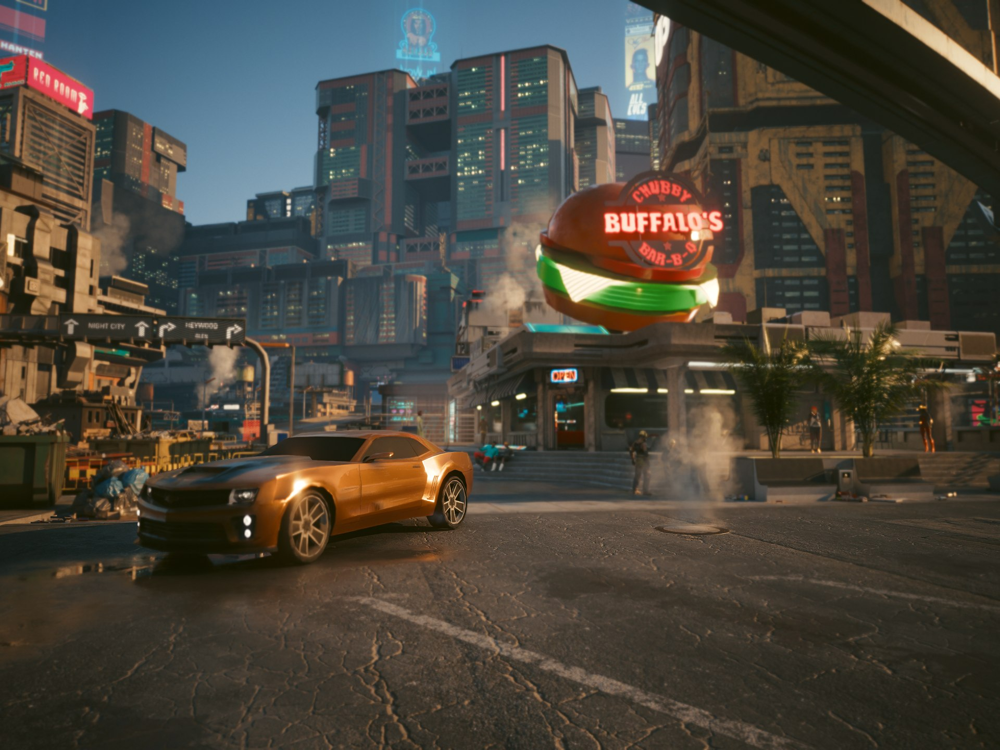
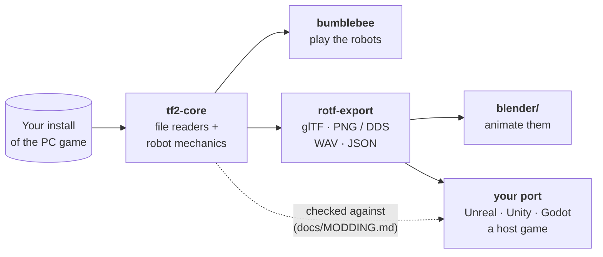
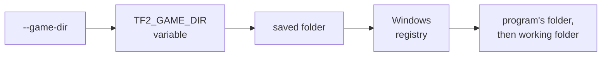
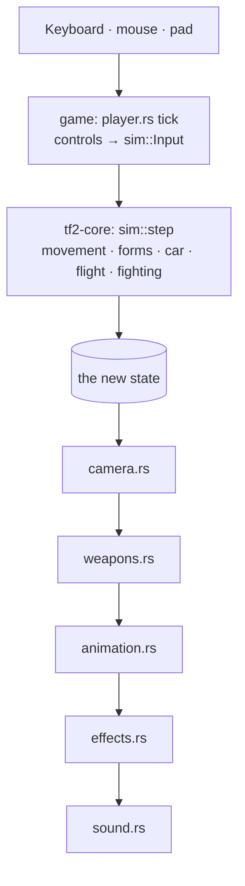

<div align="center">

# rotf-robots

**The robots of *Transformers: Revenge of the Fallen* (PC, 2009), rebuilt in Rust**

[](https://github.com/HUNK2/rotf-robots/actions/workflows/ci.yml)
[](https://github.com/HUNK2/rotf-robots/releases)
[](LICENSE)


[Download](https://github.com/HUNK2/rotf-robots/releases) ·
[Play](#playing) ·
[Export a robot](#exporting-a-robot) ·
[Porting guide](docs/MODDING.md) ·
[JSON format](docs/FORMAT.md)



<sub>Bumblebee in Cyberpunk 2077's Night City (Photo Mode).</sub>

</div>

The playable robots rebuilt in Rust: their movement, forms and changes of form, fighting,
weapons, specials, cameras, animation, damage, effects and sound, read from the game's own data,
its code and recordings of it.

> [!IMPORTANT]
> **You need your own copy of the PC game.** Nothing from the game is in this repository, and
> nothing is downloaded. Everything is read from your install, which is never written to.

This is not the whole game. There are no missions, menus, saves, cutscenes or traffic. The enemy
AI exists only so the robots have something to fight.

## What is in it

One repository holds both halves: a game that plays the robots, and a modding kit for bringing
them into another game.



| Part | What it is |
|---|---|
| **`game/`** (`bumblebee`) | A Bevy program that plays the robots, in an authored test arena or standing on one of the game's levels. |
| **`export/`** (`rotf-export`) | Writes a robot from your install as standard files: glTF models with their skeletons and animations, PNG and DDS textures, WAV sounds, and a JSON file with everything a model cannot hold (animation events, the change of form, weapons and where they mount, meshes that start hidden, hit boxes, sound events, the robot's attributes). The JSON's format is written down and versioned in [`docs/FORMAT.md`](docs/FORMAT.md). |
| **`blender/`** | A Blender add-on that imports an exported robot ready to animate: 60 fps, the hidden meshes hidden, events as markers, the vehicle's clips holding their pose, weapons on their nodes, collision shapes, and a panel that plays a change of form ([`blender/README.md`](blender/README.md)). |
| **`core/`** (`tf2-core`) | The game's file-format readers and the robots' mechanics (movement, the change of form, the car, flight, climbing, fighting, weapons, damage, cameras), as a Rust library with no engine types. The Bevy game is built on it, and it is the reference a port is checked against. |
| **`docs/`** | The research notes behind all of it, and [`docs/MODDING.md`](docs/MODDING.md), the porting guide: one for every host engine, written as tasks for the AI agent doing the port. |

## The roster

13 distinct robots, 7 that drive and 6 that fly, plus 5 reskins. Bumblebee (⭐) is the most
complete. The others play on their own attributes, health, speeds, weapons, specials and
animation sets.

| Drive 🚗 | Fly ✈️ |
|---|---|
| Bumblebee ⭐ | Jetfire |
| Optimus Prime | Breakaway |
| Ratchet | Starscream |
| Ironhide | Grindor |
| Megatron | Powered-Up Optimus |
| Long Haul | Megatron's flying form |
| Sideways | |

## You need the game

The install can be anywhere. A normal install is found by itself, through the entry its
installer leaves in the Windows registry. If yours is not found (a copied folder, or another
system), pass `--game-dir` with the folder that holds `bnxglobal.str` (or the folder just above
it). The game also asks for the folder the first time it starts and saves the answer (in
`%APPDATA%\rotf-robots\game-dir.txt`). The places it looks, in order (the first that holds the
game wins):



## Download

The [Releases page](https://github.com/HUNK2/rotf-robots/releases) has a Windows build: unzip it and
run `bumblebee.exe` to play, or `rotf-export.exe` to export a robot (its `README.txt` has the keys
and options). The Blender add-on is there too, as `rotf_import-<version>.zip`.

## Playing

To build it yourself instead, install Rust (stable) and run, from this folder:

```bash
cargo run --release -p bumblebee
cargo run --release -p bumblebee -- --character optimus
cargo run --release -p bumblebee -- --game-dir "D:\Games\Transformers Revenge of the Fallen"
```

The first build compiles Bevy and takes a while.

| Key | Does |
|---|---|
| <kbd>F1</kbd> | Shows the controls |
| <kbd>F2</kbd> | Opens the robot menu |
| <kbd>F6</kbd> / <kbd>F7</kbd> | Steps through the roster |
| <kbd>W</kbd> <kbd>A</kbd> <kbd>S</kbd> <kbd>D</kbd> + mouse | Moves, and turns the camera |
| Right mouse | Weapon mode |

The keyboard and mouse use a modern layout; `--classic-controls` gives the original's own
bindings. A pad always has the game's bindings. `--mission <Name>` loads one of the game's levels
as a stage to stand on.

[`game/README.md`](game/README.md) has the controls, every command-line flag, the capture flags
used for checking without playing, and what is real and what is a stand-in.

<details>
<summary><b>How a frame runs</b></summary>



The game updates every 0.032 s, as the original does. The camera, the weapons, animation, effects
and sound then read the new state, and the order they run in matters.

</details>

## Exporting a robot

```bash
cargo run --release -p rotf-export -- --list
cargo run --release -p rotf-export -- --character bumblebee
cargo run --release -p rotf-export -- --all
```

`--character` writes one robot into `exported/<pack>`; `--all` writes the whole roster (20 packs,
about 2 GB). `--out <folder>` picks another folder. Each robot's folder has a `README.txt`
describing its files:

```
exported/bumblebee/
├── bumblebee_robot.glb         the robot: meshes, skeleton, every clip
├── bumblebee_vehicle.glb       the vehicle form and its own clips
├── bumblebee_weapon_*.glb      each weapon (and its missiles, grenades, turrets)
├── textures/                   PNG and DDS
├── sounds/<bank>/*.wav
├── bumblebee.json              events, change of form, weapons, hit boxes, sounds
├── bumblebee_attributes.json   the robot's attributes
└── README.txt
```

To check a native port against the reference, `--character <name> --run <script.json>` plays a
script of inputs through it and writes every update's place, state, clip and events as JSON lines
(`docs/FORMAT.md`, "Reference runs"; the example scripts are `export/runs/basics.json`,
`weapons.json` and `fight.json`).

> [!WARNING]
> The exported files are made from the game and belong to its owners. Keep them on your own
> machine. A mod you share should tell its users to run `rotf-export` themselves.

## The core: the reference a port is built from

```toml
[dependencies]
tf2-core = { git = "https://github.com/HUNK2/rotf-robots", rev = "<commit>" }
```

The core is not meant to ship inside a mod: a native port rebuilds the robot from the host game's
own parts, and the core is what it is built from and checked against
([`docs/MODDING.md`](docs/MODDING.md)). Pin a commit or a release tag (`tag = "v0.2.0"`) if you use
it: the code still changes, and the core is not published on crates.io.

```bash
cargo test --workspace
```

Many tests read the install; they skip themselves when it is missing.

## How sure it is

The code marks where each piece comes from:

| Tag | Means |
|---|---|
| `[game]` | Read in the executable |
| `[data]` | Read from the game's files |
| `[trace]` | Measured in a recording of the running game |
| `[assumed]` | A guess, with what would settle it |
| `[stand-in]` | A placeholder to replace |

| System | Compared with recordings of the original | Checked by tests and captures only |
|---|:---:|:---:|
| On-foot movement | ✅ | |
| The car and its gearbox | ✅ | |
| Cameras | ✅ | |
| Climbing and strafing | ✅ | |
| Firing and aiming | | 🧪 |
| Fighting and damage | | 🧪 |
| Effects | | 🧪 |
| Flight | | 🧪 |

<sub>✅ matched against a recording of the game (all for Bumblebee). 🧪 never compared with the
original yet. Everything for the robots other than Bumblebee is 🧪.</sub>

## Layout

```
rotf-robots/
├── core/      tf2-core     file readers, tuning, the control state machine, movement, the car,
│                           flight, climbing, animation, melee, weapons, damage, cameras,
│                           particles, sound mixing
├── game/      bumblebee    the Bevy program: input, drawing, shaders, sound output, the arena
├── export/    rotf-export  the exporter
├── blender/                the Blender add-on
├── docs/                   the research notes the code cites, the JSON format, the porting guide
└── dist/                   what a release is packed from
```

## For AI agents

[`AGENTS.md`](AGENTS.md) is the guide for AI coding agents (Codex, Claude Code and others): the
rules, the commands and where each part lives. Claude Code reads it through `CLAUDE.md`.

## Legal

A fan project, not affiliated with or endorsed by Activision, Hasbro, Paramount, Luxoflux or
Beenox. Transformers and every character name are trademarks of their owners. This repository
holds only original source code. You must own the game to use it.

## License

The source code is under the MIT License ([`LICENSE`](LICENSE)). It covers only this repository's
own code: it gives no rights to the game's files or to the Transformers names and trademarks.
